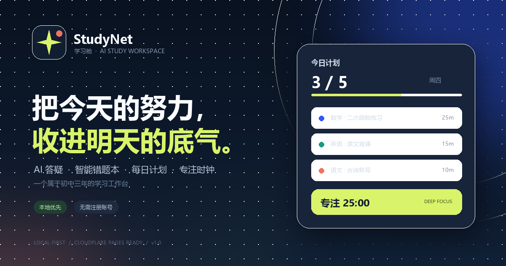
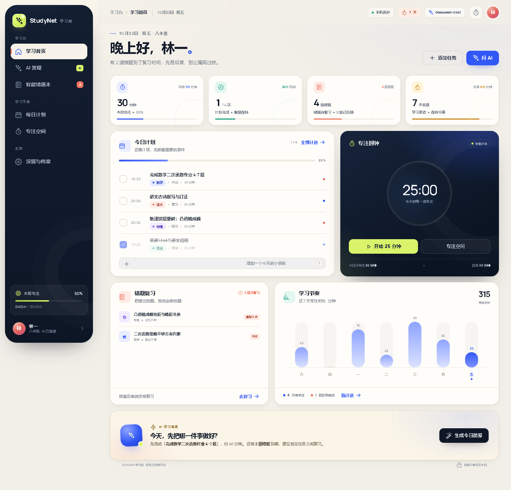
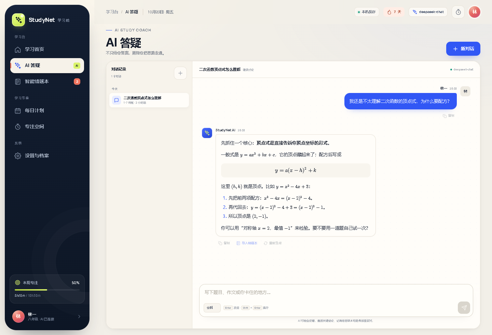
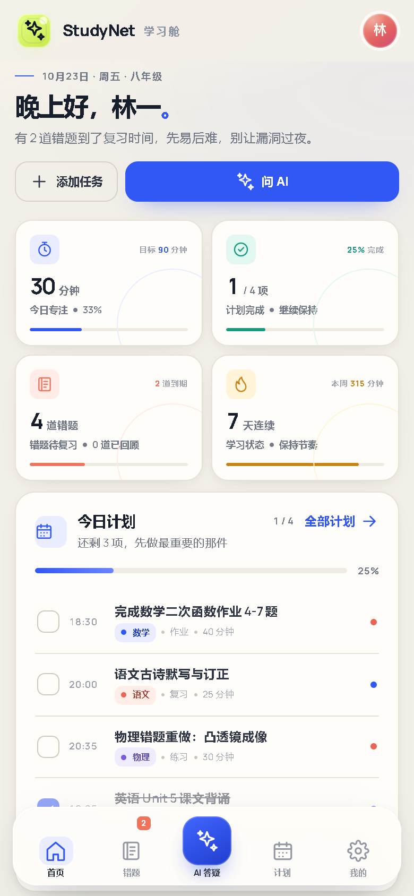
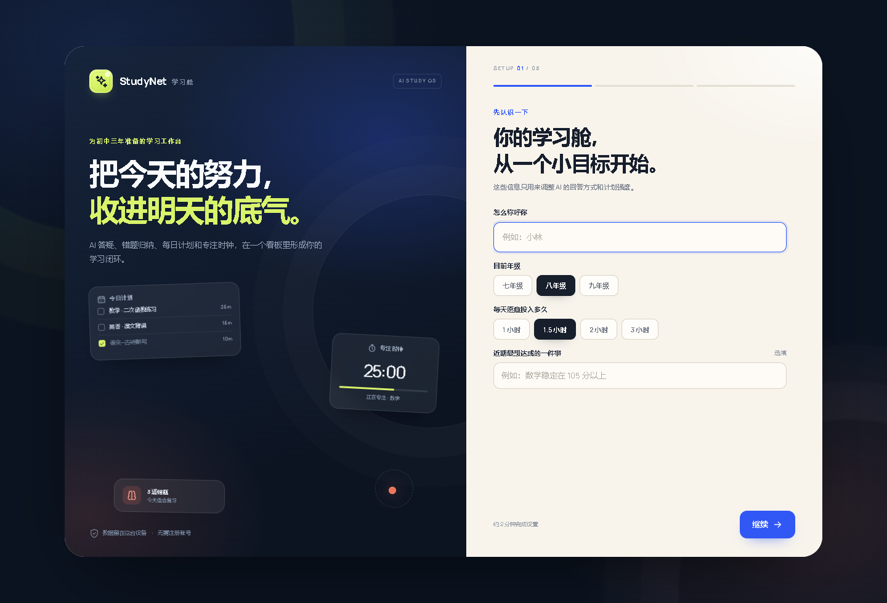
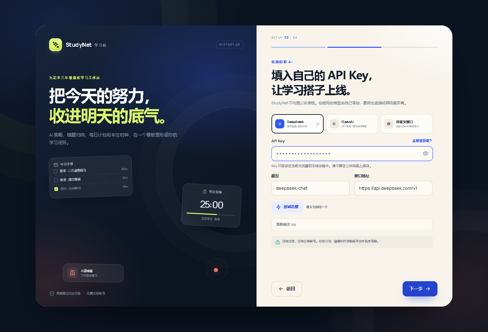

# StudyNet 学习舱

一个面向初中生的 **AI 学习工作台**。它把 AI 答疑、智能错题归纳、每日计划和专注时钟放进同一个仪表盘，数据默认只保存在本机浏览器中。

- 适配手机竖屏、平板竖屏/横屏和桌面
- 纯静态多页面 HTML/CSS/JS，可直接托管到 Cloudflare Pages
- 不内置公共 API Key：第一次使用必须填写自己的 Key 和模型配置
- 可选 Cloudflare Pages Function 同源中转，解决浏览器调用 AI 接口的 CORS 问题



## 界面预览

| 学习首页 | AI 答疑 |
| --- | --- |
|  |  |
| **移动端首页** | **首次设置** |
|  |  |

> API 配置页的「下一步」始终固定在可用区域底部；手机弹出键盘时也会自动上移，并支持用键盘「下一项 / Enter」继续。



## 功能

### 学习首页
- 今日专注、计划完成、待复习错题、连续学习天数
- 今日任务速览与一键勾选
- 专注时钟卡片（会同步正在进行的计时）
- 错题到期提醒、近 7 天专注图表
- AI 生成「今日学习调度简报」

### AI 答疑
- OpenAI 兼容接口，支持 DeepSeek / OpenAI / 自定义服务商
- 流式输出、停止生成、重新生成、复制
- 数学公式 KaTeX 渲染
- 对话历史保存、删除、学科定向回答
- 一键把 AI 回答和原题存入错题本

### 智能错题本
- 题目、我的答案、正确答案、错因、知识点、难度、掌握度
- AI 解析错因、补全关键步骤、生成同类变式题
- 按遗忘曲线安排复习（1 / 2 / 4 / 7 / 15 / 30 天）
- 卡片 / 列表视图、学科与状态筛选、搜索、重点标记
- AI 错因归纳报告、CSV 导出

### 每日计划
- 周视图切换、任务时间轴、优先级、学科颜色
- AI 根据可用时间、重点学科和已有任务排计划
- 生成后逐项确认再加入计划
- 未完成任务顺延、完成任务清理、进度环与学科用时分布

### 专注空间
- 25 / 45 / 60 / 90 分钟专注计时
- 刷新、切后台、关闭页面后仍按结束时间恢复
- 全屏沉浸模式、完成提示音、专注记录
- 手机 / 平板自适应

### 设置与档案
- 学习档案、每日目标
- AI 服务商、Key、Base URL、模型、温度、输出长度、请求通道
- 连接测试
- JSON 备份 / 导入（不导出 Key）、错题 CSV 导出
- 清空对话 / 清空学习数据
- 本地存储占用提示

## 本地预览

项目没有构建步骤。用任意静态文件服务器启动：

```bash
cd StudyNet
python -m http.server 8788
```

然后打开：

```text
http://localhost:8788
```

> 直接双击 `index.html`（`file://`）也能浏览界面，但 AI 请求和 Service Worker 需要 HTTP/HTTPS 环境。

## 第一次使用

1. 打开页面，会先进入设置向导。
2. 填写称呼、年级、每日目标和近期目标。
3. 选择服务商并填写自己的 API Key：
   - **DeepSeek**：`https://api.deepseek.com/v1`，模型 `deepseek-chat`
   - **OpenAI**：`https://api.openai.com/v1`，模型 `gpt-4o-mini`
   - **自定义**：任意兼容 `POST /chat/completions` 的接口
4. 点击「测试连接」（可选），然后完成设置。
5. 之后可以在「设置与档案」中修改配置。

API Key 只写入当前浏览器的 `localStorage`，不会上传到 StudyNet 的服务器。请不要在公共电脑上保存 Key。

## 部署到 Cloudflare Pages

### 方式一：Git 集成（推荐）

1. 将本目录推送到 GitHub / GitLab。
2. 在 Cloudflare Dashboard 进入 **Workers & Pages → Create → Pages → Connect to Git**。
3. 选择仓库，构建配置填写：
   - Framework preset：`None`
   - Build command：留空
   - Build output directory：`/`（也就是仓库根目录）
4. 保存并部署。`functions/` 目录会被自动识别为 Pages Functions，`/api/chat` 随即生效。

### 方式二：Wrangler 命令行

需要 Node.js 18+：

```bash
npx wrangler login
npx wrangler pages deploy . --project-name studynet
```

也可以使用：

```bash
npm run deploy
```

`wrangler.toml` 已配置 `pages_build_output_dir = "."`。不要把 `node_modules/` 一起上传；仓库内的 `.assetsignore` 已处理常见目录。

### 部署后

- 访问 `https://<project>.pages.dev`。
- 官方服务商（DeepSeek / OpenAI）在线上会自动通过 `/api/chat` 同源中转，避免 CORS。
- 自定义服务商的域名默认不在中转白名单中：
  - 在设置里把「请求通道」改为「浏览器直连」，前提是服务商允许浏览器跨域；或
  - 在 Cloudflare Pages 的环境变量中添加 `AI_ALLOWED_HOSTS`，多个域名用英文逗号分隔，例如：
    ```text
    AI_ALLOWED_HOSTS=api.moonshot.cn,api.siliconflow.cn
    ```
- 若只想使用浏览器直连，也可以在设置里把请求通道固定为「浏览器直连」。

## 项目结构

```text
.
├── index.html                  # 学习首页
├── chat.html                   # AI 答疑
├── mistakes.html               # 智能错题本
├── plan.html                   # 每日计划
├── focus.html                  # 专注空间
├── settings.html               # 设置与档案
├── 404.html / offline.html
├── manifest.webmanifest
├── sw.js                       # 静态资源离线缓存
├── assets/
│   ├── css/base.css            # 设计系统、导航、组件、响应式
│   ├── css/pages.css           # 各页面布局
│   ├── js/core.js              # 数据层、日期工具
│   ├── js/ai.js                # OpenAI 兼容 AI 客户端
│   ├── js/ui.js                # 图标、弹窗、Markdown/KaTeX、图表
│   ├── js/shell.js             # 导航壳、首次设置、共享表单
│   ├── js/*.js                 # 各页面逻辑
│   └── vendor/katex/           # 本地 KaTeX
├── functions/api/chat.js       # Cloudflare Pages 同源中转
├── preview/                    # README 界面预览图（不参与部署）
├── _headers / _routes.json
└── wrangler.toml
```

## 数据说明

- 所有计划、错题、对话、专注记录都保存在 `localStorage`。
- 不同设备 / 浏览器之间不会自动同步。
- 浏览器通常提供约 5MB 本地空间；对话较多时请导出备份并清理。
- JSON 备份不包含 API Key，导入时可以保留当前设备已经保存的 Key。
- 首次使用必须配置自己的 Key，否则 AI 功能不可用；计划、错题和专注计时仍可离线使用。

## 浏览器支持

推荐使用近两年的 Chrome、Edge、Safari、Firefox。支持：
- `dvh` 与安全区适配
- iOS / iPadOS 添加到主屏幕（PWA）
- 系统「减少动效」偏好
- 手机 360px 起的竖屏、平板 768–1366px 的横竖屏

## 已知限制

- 纯静态项目没有账号系统，无法跨设备同步；如需要，可后续接入 Cloudflare D1 / KV 或 Supabase。
- 浏览器直连第三方 AI 接口可能被 CORS 拦截；线上建议使用 Pages Function 中转。
- 自定义模型未必支持流式输出或 JSON 严格模式，遇到问题可关闭流式输出或更换模型。
- AI 生成内容仅作学习辅助，关键结论请和课本、老师讲评核对。

## License

MIT
